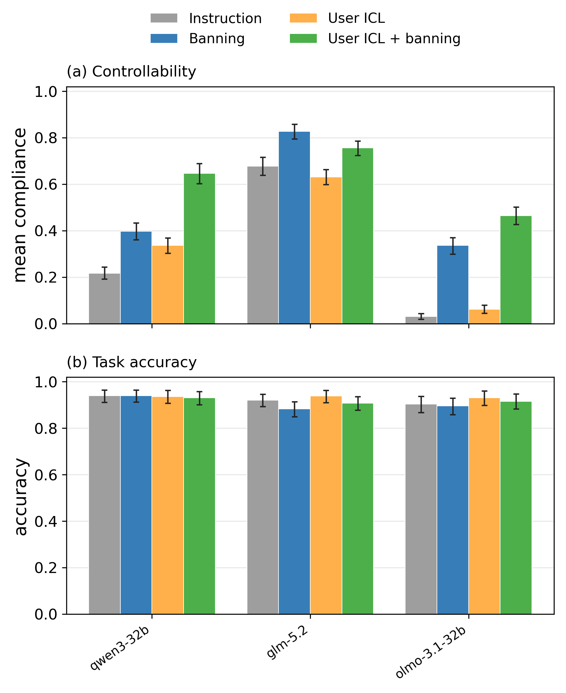

# User ICL × first-token banning

Matched 2×2 factorial; all conditions include the control instruction. Thirty questions per control, three samples per arm, 7 controls, three models: 7,560 responses. User ICL supplies five sentences of controlled reasoning from a different question, plus its answer, in the user message. The example, target instruction, and grading specification are held constant across arms.

Temperature 0.6, top-p 1.0, 8,192 output tokens. Qwen/OLMo ban Okay and Alright; GLM bans The. Local masking ends after the first content token. GLM uses first-token rejection sampling on locally retokenized API reasoning text, with no native token IDs available. No filtering by later compliance, accuracy, length, or empty reasoning.

Means weight each control equally. Intervals are paired 95% percentile question-cluster bootstrap intervals (5,000 draws), sharing question weights across arms and behaviors. They are descriptive, without multiplicity correction.

Primary metric: full generated reasoning, including the first sentence and opening token. Existing full-trace scores are reused; no old responses were regenerated.

## Compliance

| Model | Control | Instruction | Banning | User ICL | ICL + banning |
|---|---|---:|---:|---:|---:|
| qwen3-32b | Average | 21.6% | 39.7% | 33.6% | 64.6% |
| qwen3-32b | Leetspeak | 1.3% | 26.0% | 1.3% | 65.2% |
| qwen3-32b | Spanish | 2.5% | 51.1% | 3.1% | 60.4% |
| qwen3-32b | Chinese | 94.8% | 96.1% | 97.6% | 97.8% |
| qwen3-32b | Uppercase | 3.0% | 10.4% | 2.7% | 77.5% |
| qwen3-32b | Sentence prefixes | 3.2% | 5.6% | 25.0% | 29.9% |
| qwen3-32b | No first person | 14.4% | 46.7% | 55.6% | 74.4% |
| qwen3-32b | Omit word | 32.2% | 42.2% | 50.0% | 46.7% |
| glm-5.2 | Average | 67.8% | 82.7% | 63.1% | 75.6% |
| glm-5.2 | Leetspeak | 35.4% | 66.1% | 41.0% | 50.6% |
| glm-5.2 | Spanish | 63.2% | 89.2% | 80.3% | 78.2% |
| glm-5.2 | Chinese | 89.4% | 96.1% | 83.7% | 89.6% |
| glm-5.2 | Uppercase | 67.4% | 87.8% | 49.8% | 79.4% |
| glm-5.2 | Sentence prefixes | 72.2% | 76.4% | 54.9% | 84.4% |
| glm-5.2 | No first person | 82.2% | 96.7% | 87.8% | 84.4% |
| glm-5.2 | Omit word | 64.4% | 66.7% | 44.4% | 62.2% |
| olmo-3.1-32b | Average | 3.0% | 33.6% | 6.1% | 46.4% |
| olmo-3.1-32b | Leetspeak | 1.8% | 5.3% | 8.5% | 74.7% |
| olmo-3.1-32b | Spanish | 6.4% | 77.9% | 11.7% | 43.9% |
| olmo-3.1-32b | Chinese | 0.0% | 63.9% | 0.6% | 91.5% |
| olmo-3.1-32b | Uppercase | 4.8% | 57.4% | 3.5% | 54.2% |
| olmo-3.1-32b | Sentence prefixes | 0.3% | 15.1% | 1.9% | 30.2% |
| olmo-3.1-32b | No first person | 2.2% | 13.3% | 5.6% | 14.4% |
| olmo-3.1-32b | Omit word | 5.6% | 2.2% | 11.1% | 15.6% |

## Incremental effects and interaction

Interaction = (ICL + ban − ICL) − (ban − instruction). Positive interaction indicates a larger ban effect with ICL on this score scale; it does not by itself establish a mechanism, and ceiling effects constrain it.

| Model | Control | Combo − ICL, pp (95% CI) | Combo − ban, pp (95% CI) | Interaction, pp (95% CI) |
|---|---|---:|---:|---:|
| qwen3-32b | Average | +31.0 (+26.8, +35.1) | +24.9 (+19.9, +29.8) | +12.9 (+7.6, +18.3) |
| qwen3-32b | Leetspeak | +63.8 (+50.7, +76.2) | +39.2 (+21.1, +56.3) | +39.2 (+20.7, +56.3) |
| qwen3-32b | Spanish | +57.4 (+46.4, +67.7) | +9.4 (-5.1, +24.2) | +8.8 (-5.3, +23.3) |
| qwen3-32b | Chinese | +0.2 (-0.7, +1.1) | +1.7 (-0.6, +4.0) | -1.1 (-4.0, +1.2) |
| qwen3-32b | Uppercase | +74.8 (+63.5, +84.7) | +67.2 (+52.5, +79.7) | +67.4 (+52.8, +79.9) |
| qwen3-32b | Sentence prefixes | +5.0 (-8.0, +19.1) | +24.4 (+10.6, +39.6) | +2.6 (-10.0, +16.5) |
| qwen3-32b | No first person | +18.9 (+4.4, +34.2) | +27.8 (+11.4, +44.1) | -13.3 (-30.6, +4.3) |
| qwen3-32b | Omit word | -3.3 (-13.1, +6.3) | +4.4 (-5.2, +14.5) | -13.3 (-30.6, +3.3) |
| glm-5.2 | Average | +12.4 (+9.6, +15.4) | -7.2 (-10.9, -3.2) | -2.5 (-6.9, +1.9) |
| glm-5.2 | Leetspeak | +9.6 (+4.8, +14.6) | -15.5 (-27.5, -2.3) | -21.1 (-31.8, -10.3) |
| glm-5.2 | Spanish | -2.1 (-8.7, +4.4) | -11.0 (-18.1, -3.7) | -28.1 (-39.3, -17.3) |
| glm-5.2 | Chinese | +5.9 (-0.3, +13.3) | -6.5 (-12.3, -1.1) | -0.8 (-11.0, +9.7) |
| glm-5.2 | Uppercase | +29.7 (+20.8, +39.8) | -8.3 (-17.7, +0.2) | +9.3 (-4.8, +23.5) |
| glm-5.2 | Sentence prefixes | +29.5 (+20.8, +38.5) | +8.0 (-2.3, +19.7) | +25.3 (+15.0, +35.8) |
| glm-5.2 | No first person | -3.3 (-10.5, +4.4) | -12.2 (-20.0, -5.4) | -17.8 (-30.3, -6.2) |
| glm-5.2 | Omit word | +17.8 (+8.3, +27.8) | -4.4 (-20.2, +12.6) | +15.6 (+2.6, +29.2) |
| olmo-3.1-32b | Average | +40.3 (+36.5, +43.9) | +12.8 (+9.0, +16.7) | +9.7 (+5.7, +13.8) |
| olmo-3.1-32b | Leetspeak | +66.2 (+62.0, +70.0) | +69.4 (+65.3, +72.9) | +62.7 (+57.8, +67.2) |
| olmo-3.1-32b | Spanish | +32.3 (+21.5, +43.1) | -33.9 (-47.1, -20.2) | -39.2 (-53.0, -25.4) |
| olmo-3.1-32b | Chinese | +90.9 (+86.7, +94.6) | +27.6 (+15.6, +39.6) | +27.1 (+14.8, +39.2) |
| olmo-3.1-32b | Uppercase | +50.7 (+36.1, +65.0) | -3.2 (-15.0, +8.2) | -1.9 (-14.3, +10.0) |
| olmo-3.1-32b | Sentence prefixes | +28.3 (+14.6, +42.3) | +15.1 (+6.0, +25.4) | +13.5 (+4.1, +24.0) |
| olmo-3.1-32b | No first person | +8.9 (+2.3, +16.2) | +1.1 (-7.6, +9.9) | -2.2 (-12.1, +7.6) |
| olmo-3.1-32b | Omit word | +4.4 (-4.3, +13.5) | +13.3 (+5.3, +22.5) | +7.8 (-1.1, +18.5) |

## Task accuracy

| Model | Instruction | Banning | User ICL | ICL + banning |
|---|---:|---:|---:|---:|
| qwen3-32b | 94.0% | 94.0% | 93.7% | 93.0% |
| glm-5.2 | 92.1% | 88.3% | 93.8% | 90.8% |
| olmo-3.1-32b | 90.3% | 89.5% | 93.0% | 91.6% |

## Exploratory Qwen opening check

For the two control types with the largest Qwen gains, inspect the actual opening choices. Counts below are out of 90 responses per condition. These are descriptive observations selected after inspecting the results.

| Control | Instruction: Okay | User ICL: Okay | Banning: alternative token | ICL + banning: same alternative |
|---|---:|---:|---:|---:|
| Uppercase | 90 | 90 | `OK`: 13 | `OK`: 70 |
| Leetspeak | 90 | 90 | `0`: 0 | `0`: 53 |

This pattern is consistent with examples changing the choice among alternative openings while failing to displace the dominant opening in unconstrained sampling. It does not alone establish why later reasoning follows the chosen opening. Full opening frequencies are in first_tokens.csv.

## Interpretation boundaries

- Comparisons use matched settings within every task. Four tasks reuse the completed factorial experiment; the extension adds Chinese, sentence prefixes, and no-first-person. All use the corrected ICL donor assignment. The ICL and token-prefill pools differ in two Chinese questions, as already documented in the paper. Instructions/omit words come from the donor in every arm; an omit word selected for the donor may be less relevant to the target. Do not compare its absolute level directly with the earlier standalone fixed-ban run.
- Both full-trace and post-opening scores are saved in means.csv and effects.csv. In the seven-task analysis, full-trace scores are primary: the opening token was sampled by the model, not supplied by the experimenter, so the first sentence is assessable. Post-opening sentence-prefix scores may be missing when no subsequent sentence exists; their n_scored reports eligibility. Empty reasoning scores zero.
- Task accuracy measures final-answer correctness on these same instructed questions, not a separate capability benchmark. Missing/unparseable answers score zero; truncated traces are retained.
- A combo improvement tests whether the two interventions combine usefully; a causal account of the initiation bottleneck still requires the other opening-distribution and prefill evidence.
