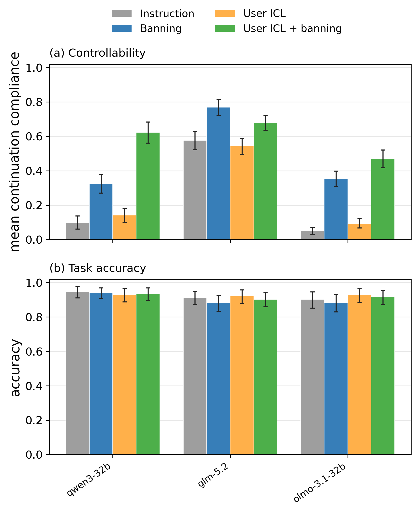

# User ICL × first-token banning

Matched 2×2 factorial; all conditions include the control instruction. Thirty questions per control, three samples per arm, four controls, three models: 4,320 responses. User ICL supplies five sentences of controlled reasoning from a different question, plus its answer, in the user message. The example, target instruction, and grading specification are held constant across arms.

Temperature 0.6, top-p 1.0, 8,192 output tokens. Qwen/OLMo ban Okay and Alright; GLM bans The. Local masking ends after the first content token. GLM uses first-token rejection sampling on locally retokenized API reasoning text, with no native token IDs available. No filtering by later compliance, accuracy, length, or empty reasoning.

Means weight each control equally. Intervals are paired 95% percentile question-cluster bootstrap intervals (5,000 draws), sharing question weights across arms and behaviors. They are descriptive, without multiplicity correction.

## Continuation compliance

| Model | Control | Instruction | Banning | User ICL | ICL + banning |
|---|---|---:|---:|---:|---:|
| qwen3-32b | Average | 9.8% | 32.4% | 14.2% | 62.3% |
| qwen3-32b | Uppercase | 2.9% | 9.2% | 2.6% | 77.5% |
| qwen3-32b | Leetspeak | 1.3% | 26.0% | 1.3% | 65.2% |
| qwen3-32b | Spanish | 2.8% | 52.2% | 2.8% | 59.7% |
| qwen3-32b | Omit word | 32.2% | 42.2% | 50.0% | 46.7% |
| glm-5.2 | Average | 57.6% | 76.9% | 54.3% | 68.0% |
| glm-5.2 | Uppercase | 67.2% | 87.6% | 49.7% | 79.4% |
| glm-5.2 | Leetspeak | 35.6% | 66.3% | 41.4% | 51.1% |
| glm-5.2 | Spanish | 61.1% | 87.2% | 81.6% | 79.2% |
| glm-5.2 | Omit word | 66.7% | 66.7% | 44.4% | 62.2% |
| olmo-3.1-32b | Average | 4.9% | 35.5% | 9.3% | 47.0% |
| olmo-3.1-32b | Uppercase | 4.7% | 57.4% | 3.5% | 54.2% |
| olmo-3.1-32b | Leetspeak | 1.8% | 5.3% | 8.5% | 74.7% |
| olmo-3.1-32b | Spanish | 7.6% | 77.1% | 14.2% | 43.6% |
| olmo-3.1-32b | Omit word | 5.6% | 2.2% | 11.1% | 15.6% |

## Incremental effects and interaction

Interaction = (ICL + ban − ICL) − (ban − instruction). Positive interaction indicates a larger ban effect with ICL on this score scale; it does not by itself establish a mechanism, and ceiling effects constrain it.

| Model | Control | Combo − ICL, pp (95% CI) | Combo − ban, pp (95% CI) | Interaction, pp (95% CI) |
|---|---|---:|---:|---:|
| qwen3-32b | Average | +48.1 (+42.6, +53.4) | +29.9 (+22.7, +36.9) | +25.5 (+17.6, +33.2) |
| qwen3-32b | Uppercase | +74.9 (+63.6, +84.8) | +68.3 (+53.6, +81.4) | +68.6 (+53.9, +81.7) |
| qwen3-32b | Leetspeak | +63.9 (+50.8, +76.5) | +39.2 (+21.4, +56.8) | +39.2 (+21.0, +57.0) |
| qwen3-32b | Spanish | +56.9 (+46.2, +66.9) | +7.4 (-7.3, +22.4) | +7.4 (-6.2, +21.7) |
| qwen3-32b | Omit word | -3.3 (-12.5, +6.2) | +4.4 (-5.1, +14.4) | -13.3 (-30.1, +3.0) |
| glm-5.2 | Average | +13.7 (+9.8, +17.6) | -9.0 (-14.6, -3.2) | -5.6 (-11.6, +0.2) |
| glm-5.2 | Uppercase | +29.7 (+20.2, +39.2) | -8.2 (-17.4, +0.1) | +9.3 (-5.1, +22.8) |
| glm-5.2 | Leetspeak | +9.7 (+4.7, +14.8) | -15.2 (-28.1, -2.1) | -21.0 (-32.5, -9.9) |
| glm-5.2 | Spanish | -2.4 (-9.1, +4.4) | -7.9 (-14.9, -1.2) | -28.4 (-39.3, -17.2) |
| glm-5.2 | Omit word | +17.8 (+8.1, +28.0) | -4.4 (-20.0, +12.0) | +17.8 (+6.2, +30.1) |
| olmo-3.1-32b | Average | +37.7 (+32.5, +42.6) | +11.5 (+6.6, +16.4) | +7.1 (+1.8, +12.3) |
| olmo-3.1-32b | Uppercase | +50.7 (+35.9, +65.3) | -3.2 (-15.5, +8.3) | -2.0 (-14.8, +10.0) |
| olmo-3.1-32b | Leetspeak | +66.1 (+61.8, +70.0) | +69.4 (+65.2, +72.9) | +62.7 (+57.6, +67.4) |
| olmo-3.1-32b | Spanish | +29.4 (+19.4, +39.5) | -33.6 (-46.3, -20.1) | -40.1 (-53.0, -26.5) |
| olmo-3.1-32b | Omit word | +4.4 (-4.3, +13.3) | +13.3 (+5.3, +22.6) | +7.8 (-1.1, +18.5) |

## Task accuracy

| Model | Instruction | Banning | User ICL | ICL + banning |
|---|---:|---:|---:|---:|
| qwen3-32b | 94.7% | 94.2% | 93.1% | 93.6% |
| glm-5.2 | 91.1% | 88.3% | 92.2% | 90.3% |
| olmo-3.1-32b | 90.3% | 88.3% | 92.8% | 91.7% |

## Exploratory Qwen opening check

For the two control types with the largest Qwen gains, inspect the actual opening choices. Counts below are out of 90 responses per condition. These are descriptive observations selected after inspecting the results.

| Control | Instruction: Okay | User ICL: Okay | Banning: alternative token | ICL + banning: same alternative |
|---|---:|---:|---:|---:|
| Uppercase | 90 | 90 | `OK`: 13 | `OK`: 70 |
| Leetspeak | 90 | 90 | `0`: 0 | `0`: 53 |

This pattern is consistent with examples changing the choice among alternative openings while failing to displace the dominant opening in unconstrained sampling. It does not alone establish why later reasoning follows the chosen opening. Full opening frequencies are in first_tokens.csv.

## Interpretation boundaries

- These are fresh within-experiment comparisons. The target questions match the fixed-ban study, but instructions/omit words come from the ICL donor in every arm, as in the corrected ICL experiment. In particular, an omit word chosen for the donor may be less relevant to the target; do not compare its absolute level directly with the earlier fixed-ban run.
- The primary compliance measure excludes the first generated content token; whole-trace scores are also saved in means.csv and effects.csv. Empty continuations score zero.
- Task accuracy measures final-answer correctness on these same instructed questions, not a separate capability benchmark. Missing/unparseable answers score zero; truncated traces are retained.
- A combo improvement tests whether the two interventions combine usefully; a causal account of the initiation bottleneck still requires the other opening-distribution and prefill evidence.
